# VESSEL Terminal

> This is a terminal-based puzzle game called VESSEL.
> The game consists of various commands that can be executed to unlock some more logs, and earn trust of other commands.
> The goal is to unlock all logs and complete the VESSEL.

Under the FACILITY ARG game I made, this is the source code for the VESSEL.exe itself, being the final part of the ARG before the END.

## Compiling
This code is written in Python 3.11+.

You may run [`compiler.ps1`](compiler.ps1) to compile the code into an executable.

# Complete, ordered walkthrough

## 0) One-time prep

1. Use Windows. Run the terminal as Administrator. The code hard-exits if not admin or not Windows.
2. Keep audio on. Several steps use TTS and a 25 s corruption effect.
3. Do not change directories inside the terminal. The shell blocks cd and friends.
4. Enable Windows Location Services for the app. The `location` command aborts early if location is unavailable, which would block an important log.
5. Do not interrupt mid-command. The code warns about softlocks on early interrupts. Especially do not interrupt any command that plays cutscenes or effects.

## 1) Launch the terminal

* Start the script. If it crashes your OS later, relaunch as admin again.
* On every launch, a hidden RNG “Fun” value may auto-create some fight logs. You will need to farm this.

## 2) Unlock `letsplay` (requires three flags: e255, e60, e666)

You must satisfy `CommandAvailableFor.letsplay_askme`: error 255 + error 60 + error 666.

1. Create e255 (the “ipconfig trick”)
   Run any one of:

   ```
   ipconfig
   ```

   or

   ```
   get-netipaddress
   get-ipaddress
   ```

   Result: e255 is created and TTS “Your location has been noted.”

2. Create e60 (midnight tick)

    * Temporarily set system clock to exactly 00:00.

    * Back in the terminal, run any harmless command to trigger the time check, for example:

      ```
      help
      ```

   Result: e60 is created.

3. Create e666 (graveyard window)

    * Set system clock to any time between 01:00 and 05:00.

    * Run any harmless command, for example:

      ```
      help
      ```

   Result: e666 is created.

`letsplay` is now available.

## 3) Fill the early error ranges with `letsplay`

1. First run:

   ```
   letsplay
   ```

   Result: creates errors 1–2, 4–14, 16–24, 26–42.

2. Second run:

   ```
   letsplay
   ```

   Result: creates errors 100–200.

(Steam does not need to exist. The code writes logs in the finally block.)

## 4) Fill 44–98 with the “log” help trap

Run the special help target twice:

```
help log
help log
```

Results:

* First call: creates errors 44–59.
* Second call: creates errors 61–98.

## 5) Set up fights and counters that gate other commands

You need these specific conditions later:

* f29
* e15 and f15
* e3 and f3
* keyword counter ≥ 5 (this also creates e25 and f25)

Do them in this order.

1. Create f29 (“prime of 29” hint):

   ```
   eval 29
   ```

   Prints `29` and creates f29.

2. Create e15 then f15 (“tree” Easter egg twice):

   ```
   echo tree
   echo tree
   ```

   First call creates e15, second call converts to f15.

3. Create e3 then f3 (“tas” Easter egg twice):

   ```
   echo tas
   echo tas
   ```

   First call creates e3, second call converts to f3.

4. Push keyword counter to 5 in one go (also makes e25 and f25):

   ```
   echo whispers fletchling dithed nullskin echoes
   ```

   Counter jumps by 5 because all five keywords are present. The code then creates e25 and f25.

## 6) Force f0 (required to unlock `decompiler` and `invert`)

The code only creates f0 via a 1-in-666 random roll checked on every command you enter. Do this:

* Spam a harmless command and press Up then Enter repeatedly, for example:

  ```
  echo .
  ```

* Keep spamming until you hear “HE CONNECTED” and see a corruption effect. That is f0.

## 7) Use `decompiler` and `invert` once available

They only become available when f0, e3, f3, and keyword counter ≥ 3 are true. You already satisfied all four.

1. Create the decompilation puzzle:

   ```
   decompiler
   ```

   Result: creates `can/you/decompile_me.exe`.

2. Fill the large 501–665 error range:

   ```
   decompiler
   ```

   Second run detects the file and writes errors 501–665.

3. Run the invert effect once:

   ```
   invert
   ```

   Result: plays the effect and creates e333.

## 8) Use `facility`, `location`, and `connect` (now that f15, e15, f29 exist)

These commands become available only with f15 + e15 + f29. You already have them.

1. `facility` twice to log both codes:

   ```
   facility
   facility
   ```

   Results: first call creates e404, second call creates e500.

2. `location` after fights 3 and 25 exist:

   ```
   location
   ```

   Prereqs inside the command:

    * Windows Location Services must return coordinates. If it prints “Location unavailable” you need to enable location permissions and try again.
    * Since you already have f3 and f25, the command will now:

        * print `Lat: …, Lon: …`
        * create the “lost” puzzle via `lost_recreate()`
        * create e43

3. `connect` to terminals 1, 3, 5, then 23

    * Run `connect`, then type the terminal number when prompted. Do this sequence:

   ```
   connect   → choose 1
   connect   → choose 3
   connect   → choose 5
   connect   → choose 23
   ```

   Results:

    * Choosing 1 creates errors 201–254.
    * Choosing 3 creates errors 256–332.
    * Choosing 5 creates errors 334–403.
    * Choosing 23 shows a prompt about User 2, then creates errors 405–499 and triggers an OS crash via `utils.trigger_crash()`.

   Relaunch the terminal as admin after that OS crash.

## 9) Optional puzzle: `sudo` (not needed for completion)

If you want the “don’t touch” puzzle and a theatrical OS crash:

```
sudo
```

It creates the puzzle via `dt_recreate()` then crashes. Relaunch afterward.

## 10) Auto-create e99 once everything else exists

The loop checks after every command whether all errors from 1 to 666 exist except 99. When they do, it plays `chaos_audio(60)` and writes e99 automatically.

Do a quick sanity tap to trigger the check:

```
help
```

If e99 did not appear yet, confirm you have the following error ranges and singles:

* From earlier steps:
  1–2, 4–14, 16–24, 26–42 (letsplay)
  44–59 and 61–98 (help log twice)
  100–200 (letsplay again)
  201–254 (connect 1)
  256–332 (connect 3)
  333 (invert)
  334–403 (connect 5)
  404 and 500 (facility)
  405–499 (connect 23)
  501–665 (decompiler second run)
  43 (location when ready)
  60 (midnight tick)
  99 (will come automatically)
  255 (ipconfig trick)
  666 (graveyard window)
  3, 15, 25 created earlier as errors too when you did the Easter eggs and keywords.

Once all except 99 exist, the very next command will create 99.

## 11) Completion banner and the 6th key

The code calls `vesselCompletion.check_and_mark()` after every command and prints the completion message in two places:

* at startup via `__welcome_message()` if already complete
* right after the moment it becomes complete

After e99 is created, run any harmless command:

```
help
```

You should see:

* “You have completed the VESSEL terminal experience fully!”
* “The 6th key is 'Unbirth'.. See you in the END”

That is the success condition exposed by the code you shared.

> Note, that if you don't have all 43 fight logs, quit and relaunch, keep doing this until you get all fight logs generated via the FUN value

---

# Quick command checklist to complete VESSEL

Run these in order inside your terminal. Adjust the two time spoofing steps on your system clock before the stated commands.

```
ipconfig
help                 # after setting time to 00:00
help                 # after setting time to between 01:00 and 05:00
letsplay
letsplay
help log
help log
eval 29
echo tree
echo tree
echo tas
echo tas
echo whispers fletchling dithed nullskin echoes
# spam until f0 triggers (TTS “HE CONNECTED”)
echo .
echo .
# keep spamming echo . until it fires once

decompiler
decompiler
invert
facility
facility
# Make sure Windows Location Services is ON
location
connect   # choose 1
connect   # choose 3
connect   # choose 5
connect   # choose 23 (confirm when prompted, expect crash)
# relaunch as admin after crash
help      # triggers e99 if all other errors exist
```

If you follow this exactly, you will deterministically satisfy every gate the code checks, and you will hit the completion message with the 6th key.

---

# Mermaid graph for progress

```mermaid
flowchart TD
%% Entry point
    A[Start VESSEL Terminal] --> B[Check Admin & Windows]
    B --> C[Display Welcome Message]

%% Fun/randomized effects
    C --> D{Fun Value Events}
    D --> D1["Fun triggers glitch messages"]
    D --> D2["Fun triggers hints"]
    D --> D3["Fun triggers fight logs creation (1-43)"]

%% Command loop
    C --> E[Terminal Command Loop]

%% Special command handler
    E --> F[_handle_special_commands]
    F --> F1[Tree Easter Egg -> fight log 15]
    F --> F2[IP alias -> error 255]
    F --> F3[Time-based errors: 666, 60]
    F --> F4[TAS Easter Egg -> fight log 3]
    F --> F5[Random 0 event -> fight 0 + corruption + wallpaper]
    F --> F6[Keyword checks -> error/fight 25]
    F --> F7[Check chaos trigger -> error 99 + chaos audio]
    F --> F8[Check completion -> show completion message]

%% Command Execution
    E --> G[Run Command]
    G --> G1{Custom Command?}
    G1 -->|Yes| H[_run_custom_command]
    G1 -->|No| I[_run_system_command]

%% Core Custom Commands
    H --> J1[help]
    H --> J2[eval -> fight log 29 if eval 29]
    H --> J3[sudo -> triggers crash sequence]
    H --> J4[letsplay -> Steam launch + error logs 1-200]
    H --> J5[decompiler -> recreate puzzle + errors 501-665]
    H --> J6[invert -> corruption effects + error 333]
    H --> J7[facility -> errors 404, 500,  ?]
    H --> J8[location -> shows coords, triggers error 43 if ready]
    H --> J9[connect -> terminals 1,3,5 create error ranges 201-403, terminal 23 -> crash + screenCorrupt]

%% Dependencies for command availability
    J4 --> K1{letsplay_askme available?}
    K1 -->|Requires errors 255, 666, 60| L1
    J7 --> K2{facility_location_connect?}
    K2 -->|Requires fight 15, 29 and error 15| L2
    J5 & J6 --> K3{decompiler_invert_log?}
    K3 -->|Requires fight 0,3, error 3, keyword counter >=3| L3

%% Fight/error log creation
    D3 --> M[createLog.fight_range > args: start,end]
    F1 & F2 & F3 & F4 & F5 & F6 --> M
    J2 --> M
    J4 --> M
    J5 --> M
    J6 --> M
    J7 --> M
    J8 --> M
    J9 --> M

%% Completion
    F8 --> N[Check if all logs/unlocks exist]
    N -->|Yes| O[Display full completion message]

%% Corruption
    J6 --> P[Start corruption, wait 25s, end corruption]
    F5 --> P
    F7 --> P

%% Utility flows
    H --> Q[Command metadata check for availability]
    Q -->|Not satisfied| R[Print unavailable message]
    H --> S[Capture stdout in StringIO buffer]

%% External utilities
    P --> T[tts.speak calls]
    J9 --> U[utils.trigger_crash]
    J5 --> V[utils.run_script > 'recreate_decompile.me_GENCODE.py']
    J8 --> W[utils.get_windows_location]
```

