# VESSEL Terminal

> This is a terminal-based puzzle game called VESSEL.
> The game consists of various commands that can be executed to unlock some more logs, and earn trust of other commands.
> The goal is to unlock all logs and complete the VESSEL.

Under the FACILITY ARG game I made, this is the source code for the VESSEL.exe itself, being the final part of the ARG before the END.

# Guide

Here’s a **step-by-step Markdown guide** for fully completing the `VESSEL.exe` ARG terminal, 
incorporating all the mechanics, logs, and commands from your source code. 
This ensures you can reach 100% completion.

---

# VESSEL.exe Full Completion Guide

## 1. Start the Terminal

* Run `VESSEL.exe` as **Administrator** on **Windows**.
* The terminal will display a welcome message, including:

    * Time-based greetings
    * Random “Fun” messages (glitchy outputs, tips, or hints)
    * Fight log creation based on the random Fun value

> Note: Do **not** delete the logs. If you move logs, copy them instead.

---

## 2. Understand the Logs

* **Error logs** (`error`) gate command availability.
* **Fight logs** (`fight`) are triggered by actions, easter eggs, or certain commands.
* **Special logs**:

    * `0`, `3`, `15`, `25`, `29`, `255`, `60`, `666` are crucial for unlocking commands.

---

## 3. Early Easter Eggs & Triggers

* **Tree Easter Egg**

    * Type any command containing `"tree"` → triggers `fight log 15`.
* **IP / Network Easter Egg**

    * Use `ipconfig`, `get-netipaddress`, or `get-ipaddress` → triggers `error 255`.
* **TAS Easter Egg**

    * Type any command containing `"tas"` → triggers `fight log 3`.
* **Time-based logs**

    * Run terminal between `01:00–05:00` → triggers `error 666`.
    * Run at `00:00` → triggers `error 60`.
* **Random 0 Event**

    * Randomly triggers fight 0 + corruption effects + wallpaper creation.

---

## 4. Core Commands to Unlock

### 4.1 help

* Use `help` to see available commands.
* Use `help <command>` for hints and metadata.
* Certain hints only appear if prerequisite logs exist.

### 4.2 eval

* Evaluate expressions like `eval 2 + 3`.
* Special case: `eval 29` → triggers `fight log 29`.

### 4.3 sudo

* Triggers crash sequence (for completeness, do **not** run unless intended).

### 4.4 letsplay

* Opens Steam if installed.
* Prerequisite: `error 255`, `error 666`, `error 60` must exist.
* Running it will generate multiple errors (`1–200`).

### 4.5 decompiler

* Creates `decompile_me.exe` puzzle.
* Prerequisite: `fight 0`, `fight 3`, `error 3`, and keyword counter >= 3.
* Re-running generates errors `501–665`.

### 4.6 invert

* Starts corruption effects for 25 seconds.
* Requires the same prerequisites as `decompiler`.
* Generates `error 333`.

### 4.7 facility

* Connects to the facility and triggers `errors 404` and `500`.
* Requires `fight 15`, `fight 29`, and `error 15`.

### 4.8 location

* Displays coordinates (latitude & longitude).
* If `fight logs 3, 15, 25` are missing → warning.
* If ready → triggers `error 43` and may run `recreate_lost_GENCODE.py`.

### 4.9 connect

* Connects to terminals:

    * Terminals 1, 3, 5 → create error ranges 201–403.
    * Terminal 23 → requires previous terminals, triggers screen corruption & crash.

---

## 5. Keyword Mechanics

* Type keywords: `"whispers"`, `"fletchling"`, `"dithed"`, `"nullskin"`, `"echoes"`.
* Each keyword increments the counter.
* Reaching **5 total** triggers:

    * `fight log 25`
    * `error 25`

---

## 6. Full Completion Steps

1. Trigger **Tree** Easter Egg → fight 15
2. Trigger **IP** Easter Egg → error 255
3. Trigger **TAS** Easter Egg → fight 3
4. Ensure **time-based errors** exist → errors 60 and 666
5. Type at least **5 keywords** → fight & error 25
6. Use `eval 29` → fight 29
7. Run `letsplay` → errors 1–200
8. Run `decompiler` → puzzle & errors 501–665
9. Run `invert` → corruption effects + error 333
10. Run `facility` → errors 404 & 500
11. Run `location` → coordinates + error 43 if ready
12. Run `connect` → terminals 1,3,5,23 to finish terminal log
13. Ensure fight logs 0,3,15,25,29 exist → triggers final completion
14. Completion message appears:

    ```
    You have completed the VESSEL terminal experience fully!
    The 6th key is 'Unbirth'.. See you in the END
    ```

---

## 7. Tips & Warnings

* Always **keep audio on** for TTS hints.
* Never **exit mid-command** → may cause softlocks.
* Logs cannot be deleted or moved; copy if needed.
* Some events are random (`fight 0`, Fun value fight ranges), so multiple runs may be needed.

---

This ensures **100% completion**, unlocking all fights, errors, and terminal commands while witnessing all ARG triggers.

---

# Mermaid graph for progress

```mermaid
flowchart TD
%% Entry point
    A[Start VESSEL Terminal] --> B[Check Admin & Windows]
    B --> C[Display Welcome Message]

%% Fun/randomized effects
    C --> D{Fun Value Events}
    D --> D1["Fun triggers glitch messages"]
    D --> D2["Fun triggers hints"]
    D --> D3["Fun triggers fight logs creation (1-43)"]

%% Command loop
    C --> E[Terminal Command Loop]

%% Special command handler
    E --> F[_handle_special_commands]
    F --> F1[Tree Easter Egg -> fight log 15]
    F --> F2[IP alias -> error 255]
    F --> F3[Time-based errors: 666, 60]
    F --> F4[TAS Easter Egg -> fight log 3]
    F --> F5[Random 0 event -> fight 0 + corruption + wallpaper]
    F --> F6[Keyword checks -> error/fight 25]
    F --> F7[Check chaos trigger -> error 99 + chaos audio]
    F --> F8[Check completion -> show completion message]

%% Command Execution
    E --> G[Run Command]
    G --> G1{Custom Command?}
    G1 -->|Yes| H[_run_custom_command]
    G1 -->|No| I[_run_system_command]

%% Core Custom Commands
    H --> J1[help]
    H --> J2[eval -> fight log 29 if eval 29]
    H --> J3[sudo -> triggers crash sequence]
    H --> J4[letsplay -> Steam launch + error logs 1-200]
    H --> J5[decompiler -> recreate puzzle + errors 501-665]
    H --> J6[invert -> corruption effects + error 333]
    H --> J7[facility -> errors 404, 500,  ?]
    H --> J8[location -> shows coords, triggers error 43 if ready]
    H --> J9[connect -> terminals 1,3,5 create error ranges 201-403, terminal 23 -> crash + screenCorrupt]

%% Dependencies for command availability
    J4 --> K1{letsplay_askme available?}
    K1 -->|Requires errors 255, 666, 60| L1
    J7 --> K2{facility_location_connect?}
    K2 -->|Requires fight 15, 29 and error 15| L2
    J5 & J6 --> K3{decompiler_invert_log?}
    K3 -->|Requires fight 0,3, error 3, keyword counter >=3| L3

%% Fight/error log creation
    D3 --> M[createLog.fight_range > args: start,end]
    F1 & F2 & F3 & F4 & F5 & F6 --> M
    J2 --> M
    J4 --> M
    J5 --> M
    J6 --> M
    J7 --> M
    J8 --> M
    J9 --> M

%% Completion
    F8 --> N[Check if all logs/unlocks exist]
    N -->|Yes| O[Display full completion message]

%% Corruption
    J6 --> P[Start corruption, wait 25s, end corruption]
    F5 --> P
    F7 --> P

%% Utility flows
    H --> Q[Command metadata check for availability]
    Q -->|Not satisfied| R[Print unavailable message]
    H --> S[Capture stdout in StringIO buffer]

%% External utilities
    P --> T[tts.speak calls]
    J9 --> U[utils.trigger_crash]
    J5 --> V[utils.run_script > 'recreate_decompile.me_GENCODE.py']
    J8 --> W[utils.get_windows_location]
```

